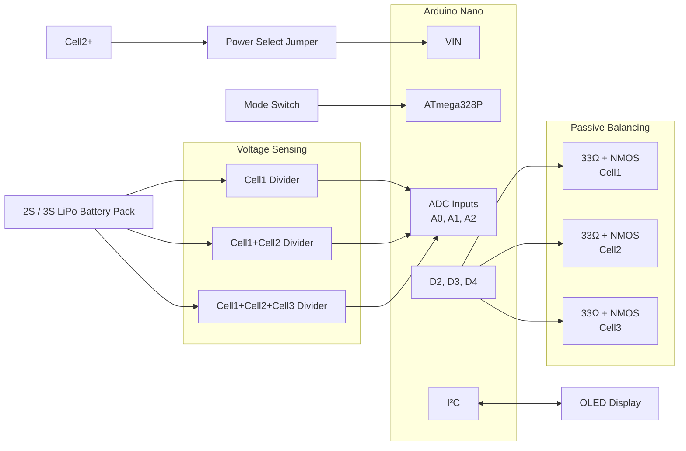
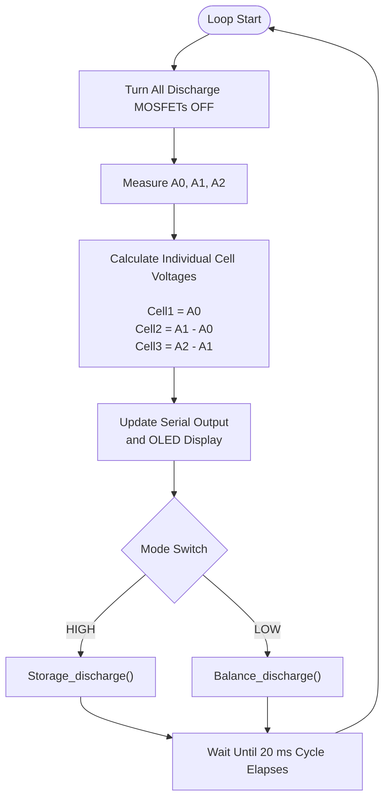
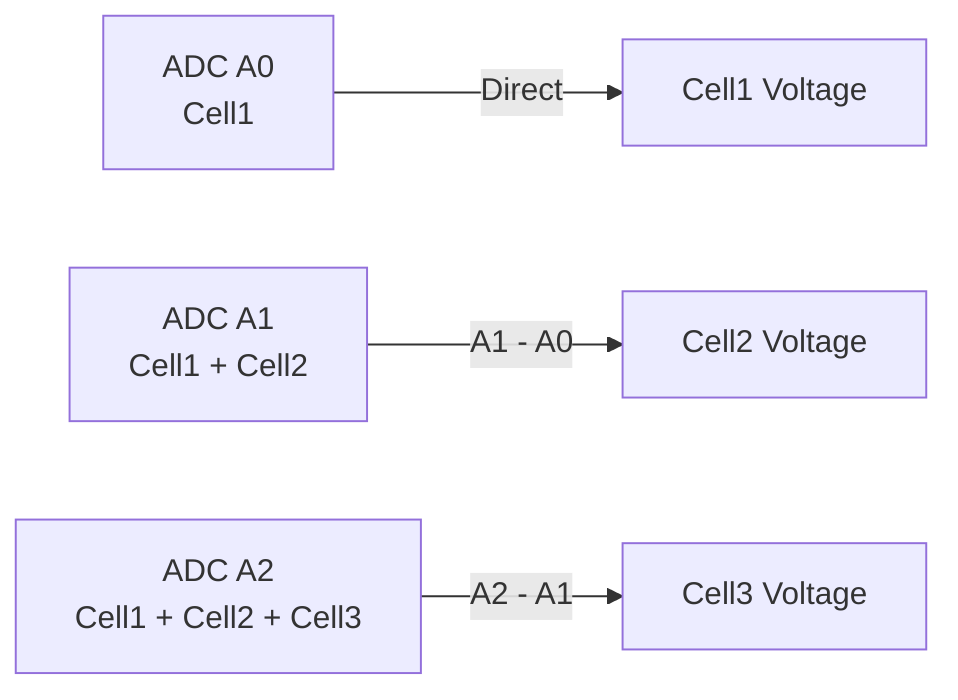

# passive-lipo-balancer-nano

A proof-of-technology passive LiPo cell balancer based on Arduino Nano.

This project monitors individual battery cell voltages and performs passive balancing by selectively discharging cells through resistors. It is intended for educational, research, and hobby robotics applications.

The firmware currently focuses on two practical operating modes:

- **Storage Mode**: Automatically discharges all cells to a storage voltage of approximately **3.8 V per cell**.
- **Balance Mode**: Discharges higher-voltage cells until all cells match the voltage of the lowest cell in the pack.

The goal of this project is to provide a simple and easy-to-understand platform for learning battery management and cell balancing techniques.

## Features

- Individual cell voltage monitoring
- Passive balancing using discharge resistors
- Storage Mode (~3.8 V/cell)
- Balance Mode (equalize all cells to the lowest cell voltage)
- Arduino Nano (ATmega328P) based design
- Simple and low-cost hardware implementation
- Open-source hardware and firmware
- Suitable for Li-ion and LiPo battery packs

## Hardware

### Main Components

- Arduino Nano (ATmega328P)
- Cell voltage sensing circuits
- MOSFETs for discharge control
- Discharge resistors
- Battery balance connector
- Status OLED (optional)

### Mermaid

##### Circuit Architecture

The Arduino Nano is powered directly from the Cell2+ node (approximately 7.4–8.4 V) through VIN when JP1 is installed. Cell voltages are measured through resistor dividers, while individual cells are balanced by switching dedicated MOSFET-resistor discharge paths.

#### Control Flow

#### Cell Voltage Reconstruction

### BOM
[PartsCabi.net](https://partscabi.net/list/e6f96d02-e6a8-4c4d-9230-7bf2f09aacb4)

## Operating Modes

### Storage Mode

Storage Mode is intended for preparing LiPo battery packs for long-term storage.

The balancer discharges cells until each cell reaches approximately **3.8 V**, which is commonly considered a suitable storage voltage for LiPo batteries.

### Balance Mode

Balance Mode reduces voltage differences between cells.

The firmware identifies the cell with the lowest voltage and selectively discharges higher-voltage cells until all cells reach approximately the same voltage.

## Safety Notice

This project works directly with rechargeable lithium-based batteries.

Improper handling of Li-ion or LiPo batteries may result in overheating, fire, property damage, or personal injury.

Always:

- Verify connections before powering the circuit
- Use appropriate fuses and wiring
- Monitor batteries during testing
- Never leave batteries unattended while charging or balancing

The author assumes no responsibility for any damage, injury, or loss resulting from the use of this project.

## Project Status

⚠️ This is an experimental proof-of-technology project.

The hardware and firmware are under active development and should not be considered a certified battery management system (BMS).

## Contributing

Contributions, bug reports, and suggestions are welcome.

Feel free to open an issue or submit a pull request.

## License

This project is licensed under the MIT License.

See the `LICENSE` file for details.
